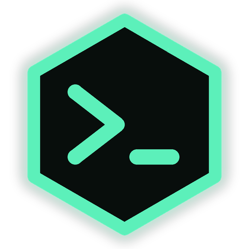
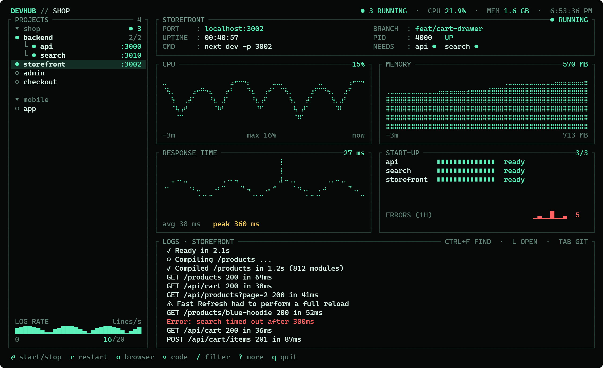

<p align="center">
  
</p>

<h1 align="center">DevHub CLI</h1>

<p align="center">
  A terminal dashboard to run, watch and manage the dev servers of a multi-repo project.<br>
  One screen, one key per action.
</p>



> **v2** is a rewrite in Rust. The original PowerShell menu is kept at the
> [`v1-powershell`](../../tree/v1-powershell) tag.

## Features

- **One screen**: your projects on the left; for the selected one, live charts and its log.
- **Organized by product**: foldable sections (`←` / `→`), remembered between runs.
- **Auto-discovery**: point it at a folder and every project inside shows up.
- **Groups**: start `docker → api → web` with one key, each step waiting for the last.
- **Shared dependencies**: `needs = ["api"]` starts the API first, only if it isn't running already.
- **Servers outlive the app**: close DevHub (or let it crash) and your servers keep running; open it again and it reattaches, logs included. On quit you choose: stop all, or leave running.
- **Neon dashboard**: CPU, memory and response-time charts, start-up progress, errors per hour, log rate and port health per server.
- **Git built in**: branches newest first, recent commits, a branch switcher (`b`) that fetches in the background, and `git pull` (`p`, fast-forward only).
- **Logs**: find (`ctrl+f`, then `n` / `N`), follow, clear, or open the full log in your editor (`L`).
- **Open anywhere**: VS Code, Zed, Antigravity, file explorer, or `localhost:port` in the browser.

## Install

**Download:** grab the file for your system from the
[latest release](../../releases/latest), unzip it, and put `devhub` (`devhub.exe`
on Windows) somewhere on your `PATH`.

**Or build it** with [Rust](https://rustup.rs), from this folder:

```bash
cargo install --path .
```

Run `devhub` from any terminal, or `devhub --focus` for a borderless, maximised Windows Terminal window.

## Config

On first run DevHub writes a starter config to `%APPDATA%\devhub\config.toml`
(`~/.config/devhub/config.toml` on Linux). Press `,` inside DevHub to edit it and
`R` to reload. See [config.example.toml](config.example.toml) for every option.

```toml
# Every folder with a package.json here shows up on its own.
[[roots]]
path = '~/code/frontend'
category = "Frontend"
cmd = "npm run dev"

# Start the API first, unless it already runs.
[[repos]]
path = '~/code/frontend/shop'
needs = ["api"]

# Several steps with one key.
[[groups]]
name = "stack"
steps = [
  { path = '~/code/stack', cmd = "docker compose up -d", wait_exit = true, stop = "docker compose stop" },
  { path = '~/code/stack/api', cmd = "npm run dev", wait_port = 3000 },
  { path = '~/code/stack/web', cmd = "npm run dev" },
]
```

## Keys

| Key | Action |
| --- | --- |
| `↑↓` `j` `k` | move |
| `enter` | start / stop (on a section: fold) |
| `←` `→` | fold / unfold a section |
| `r` / `s` / `S` | restart / stop / stop everything |
| `o` | open `localhost:port` in the browser |
| `v` `z` `a` `e` | open in VS Code / Zed / Antigravity / file explorer |
| `tab` | log ↔ git |
| `b` / `p` | switch git branch / `git pull` |
| `/` | filter projects |
| `ctrl+f` `n` `N` | find in the log |
| `pgup` `pgdn` `f` `c` `L` | scroll / follow / clear / open the log |
| `,` / `R` | edit / reload the config |
| `?` | all keys |
| `q` | quit: stop all, or leave running |

## How it works

- Servers run hidden; their output goes to log files in `%LOCALAPPDATA%\devhub\logs`, which DevHub follows live. That's what lets them outlive it.
- What DevHub started is listed in `running.toml` next to the logs; a new DevHub checks those processes (by pid and start time) and reattaches.
- CPU and memory are sampled every 2 s over each server's whole process tree; response times are read from request lines in the log (`GET /api 200 in 38ms`); the port is checked every 2 s.
- Windows is the main target; the code also builds for macOS and Linux.

## License

MIT
