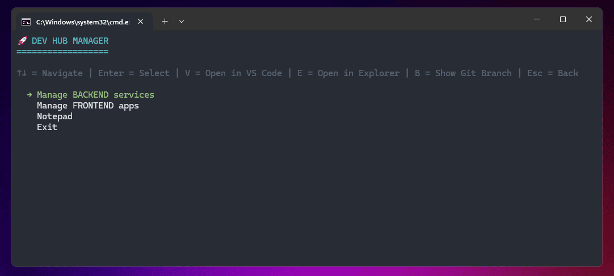
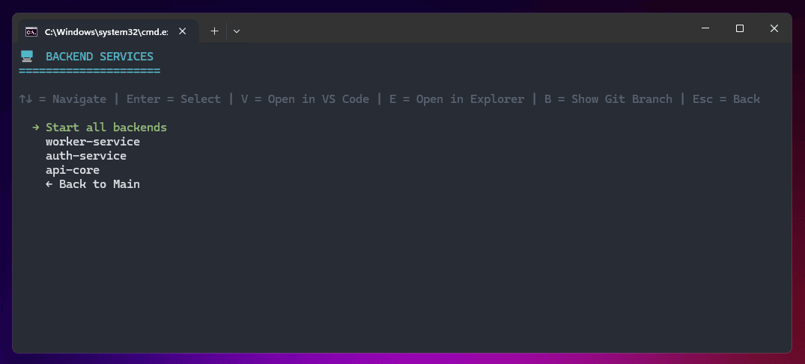

# 🚀 DevHub CLI

A powerful, interactive PowerShell-based environment manager for multi-repo projects. DevHub simplifies your workflow by centralizing the management of frontend and backend services, allowing you to launch, explore, and debug with just a few keystrokes.




## ✨ Features

- **Interactive Menu:** Navigate through your repositories using arrow keys.
- **One-Click Start:** Launch all backend services or individual apps in new terminal windows.
- **Deep Integration:**
  - `V` - Quickly open any repository in **VS Code**.
  - `E` - Open the repository folder in **File Explorer**.
  - `B` - Instantly check the current **Git Branch** of any repo.
- **Customizable:** Easily configure your own project paths and service names.
- **Lightweight:** Pure PowerShell script with a fast, responsive interface.

## 🛠️ Installation

1. **Clone the repository:**

   ```bash
   git clone https://github.com/your-username/devhub-cli.git
   cd devhub-cli
   ```

2. **Run the script:**
   You can start the manager by running the `start.bat` file or executing the PowerShell script directly:
   ```powershell
   ./dev-manager.ps1
   ```

## ⚙️ Configuration

To adapt DevHub to your own project, edit the hashtags at the top of `dev-manager.ps1`:

### 1. Backend & Frontend Services

Add your project repositories here. Each entry automatically gets options to launch, open in VS Code, or check Git branches.

```powershell
$Backends = @{
    "api-core" = "C:\Path\To\Your\Backend"
}

$Frontends = @{
    "main-app" = "C:\Path\To\Your\Frontend"
}
```

### 2. Other Tools & Apps

Need to launch a notes app, a database manager, or any other `.exe`? Just add it to the `$OtherApps` list:

```powershell
$OtherApps = @{
    "Notepad"    = "notepad.exe"
}
```

## ⌨️ Hotkeys

| Key       | Action                                |
| --------- | ------------------------------------- |
| `↑` / `↓` | Navigate Menu                         |
| `Enter`   | Launch / Select                       |
| `V`       | Open in VS Code (Services only)       |
| `E`       | Open in File Explorer (Services only) |
| `B`       | Check Git Branch (Services only)      |
| `Esc`     | Back to Main Menu / Exit              |

## 🚀 Future Roadmap

- [ ] **System Health Check:** Startup validation for `git`, `npm`, and `code` commands.

---

Created with ❤️ for developers who love efficiency.
